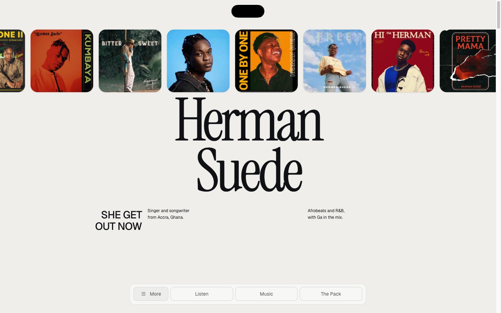
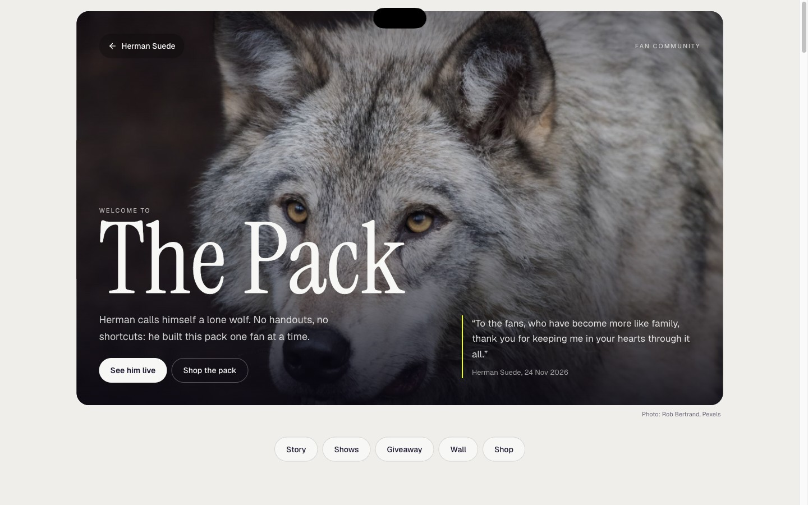
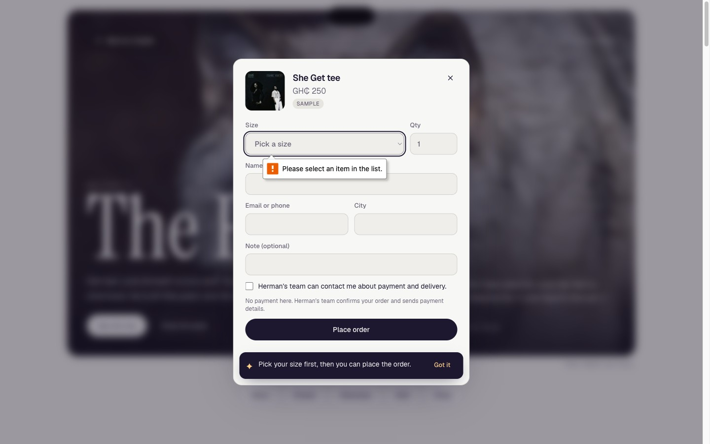

# Herman Planet

A home for Herman Suede where fans hear a song, learn how it was made, and join his community, while his team runs everything from one private page.

**Live:** [herman-planet.vercel.app](https://herman-planet.vercel.app) · **Docs:** [docs/](docs/README.md) · **Studio access:** [ACCESS.md](ACCESS.md)



## What is it?

| Part | What it does | Status |
|---|---|---|
| **Fan site** | His music, the new single, every release with its story, a mood dial, videos | Required |
| **Song pages** | `/t/<song>`: the full song, timed notes on how it was made, credits, a link to any moment | Required |
| **The Pack** | `/pack`: his story in chapters, shows and meetups with tickets, merch, unreleased music, giveaways, a fan wall | Required |
| **Studio** | `/studio`: the team's admin, behind an access code | Required |
| **Help tips** | Spots a fan who is stuck and offers one line of help, written by [SERV Reasoning](https://docs.openserv.ai) | Optional; without a key, built-in tips are used |
| **Payments** | Card and mobile money through [Bachs](https://bachs.io) | Optional; without it, the team contacts the buyer |



## How it works

```text
            A fan opens a shared song link
                          |
                          v
     Song page starts at the marked moment, with notes
                          |
                          v
       The Pack: shows, merch, giveaway, fan wall
                          |
                          v
     Pay with Bachs   or   Herman's team contacts you
                          |
                          v
     Studio: the team approves, ships and answers
```

Nothing a fan sees goes live until the team approves it in Studio. An order is marked Paid only when Bachs confirms it.

### Help tips



The browser watches how the pointer moves, presses and scrolls. It flags three patterns: repeated presses on one spot, circling, and scrolling up and down. It also catches a required field the browser refused and a submit the server turned down. When one of these happens, it sends a short summary to `/api/help`: the mood, the page, and the name of the control involved. SERV writes one line of help and may pick a link from a fixed list of real pages. The tip shows in the island, or inside the sheet if a buy or ticket sheet is open.

Typed text and field values never leave the page. Tips appear at most once every 45 seconds, and while someone is buying or booking, at most once every 12 seconds.

## Why use it?

**Fans land in the moment that matters.** A shared link starts the song at the marked second, not at 0:00.

**The story is true.** Every note, chapter and number comes from Herman's team or a named source.

**Fewer abandoned orders.** A fan who can't find the size field or keeps pressing a disabled button gets told how to fix it, right in the sheet.

**The team runs it without a developer.** Photos, prices, show dates and giveaways are all managed in Studio.

**It takes payments the way Ghana pays.** Card and mobile money through Bachs.

How well it works depends on the team keeping Studio up to date. Stream counts are dated snapshots.

## Install

Requires Node.js 22+ and a free [Neon](https://neon.com) Postgres database.

```bash
git clone https://github.com/fozagtx/herman-planet.git
cd herman-planet
npm install
cp .env.example .env.local
npm run db:migrate
npm run db:seed
```

## Quick start

**Full: payments and help tips**

```bash
npm run db:seed-pack
npm run dev
```

Fill in `BACHS_API_KEY`, `BACHS_WEBHOOK_SECRET` and `SERV_API_KEY` first. See [Payments with Bachs](docs/payments-bachs.md) for the Bachs setup.

**No payments**

```bash
npm run dev
```

Leave the Bachs variables empty. Fans still order and book; the team contacts them from Studio.

**Just the music**

```bash
npm run db:seed && npm run dev
```

Then open `/studio` and enter your `STUDIO_ACCESS_CODE`.

## Configuration

| Variable | Required | Purpose |
|---|---|---|
| `DATABASE_URL` | Yes | Neon pooled connection |
| `DATABASE_URL_UNPOOLED` | Yes | Neon direct connection, for migrations |
| `NEXT_PUBLIC_SITE_URL` | Yes | Public address, for share images and checkout returns |
| `STUDIO_ACCESS_CODE` | Yes | The team's code for Studio |
| `SERV_API_KEY` | For help tips | Key from [console.openserv.ai](https://console.openserv.ai) |
| `SERV_MODEL` | No | Defaults to `gpt-5.4-mini` |
| `BACHS_API_KEY` | For payments | `sk_sandbox_` to test, `sk_live_` for real money |
| `BACHS_WEBHOOK_SECRET` | For payments | Signing secret of your Bachs webhook |

Keep keys in `.env.local` and in Vercel, never in chats or screenshots.

> [!WARNING]
> A variable exported in your shell overrides `.env.local`. If help tips fall back to built-in text locally, check `echo $SERV_API_KEY`.

## Useful commands

```text
npm run dev             start locally
npm run build           production build
npm run lint            lint
npm run db:generate     write a migration after changing src/db/schema.ts
npm run db:migrate      apply migrations
npm run db:seed         She Get and its timed notes
npm run db:seed-pack    sample Pack content, tagged Sample
vercel deploy --prod    deploy
```

## Documentation

| Guide | For |
|---|---|
| [Getting started](docs/getting-started.md) | Running it on your machine |
| [Configuration](docs/configuration.md) | Every setting, and the Studio access code |
| [Studio guide](docs/studio-guide.md) | Notes, merch, shows, giveaways, fan wall |
| [Payments with Bachs](docs/payments-bachs.md) | Sign up, keys, webhook, testing, going live |
| [Deployment](docs/deployment.md) | Your own copy on Vercel |
| [API reference](docs/api-reference.md) | Pages, routes, server actions |
| [Data model](docs/data-model.md) | Tables and their rules |
| [Content and sources](docs/content-and-sources.md) | Where every fact and image comes from |
| [Design system](docs/design-system.md) | Colours, type, components |
| [Troubleshooting](docs/troubleshooting.md) | Common problems |

## Important limits

- Herman's team is the final authority. Fans see only approved notes, featured wall posts, and live items and events.
- Every Studio action checks the access code again on the server.
- Card and mobile money details never touch this site.
- Sample content is tagged Sample and is never charged.
- Help tips never send typed text or field values. SERV can only link to pages on a fixed list.
- When a fan isn't signed in to Spotify, song pages play Spotify's 30 second preview and say so.

## Update

```bash
git pull && npm install && npm run db:migrate && vercel deploy --prod
```

## Remove

Delete the Vercel project and the Neon project, and revoke the Bachs and SERV keys.

## Development

```bash
npm install
npx tsc --noEmit
npm run lint
npm run build
```

## License

Private. All rights reserved by Herman Suede and his team.
